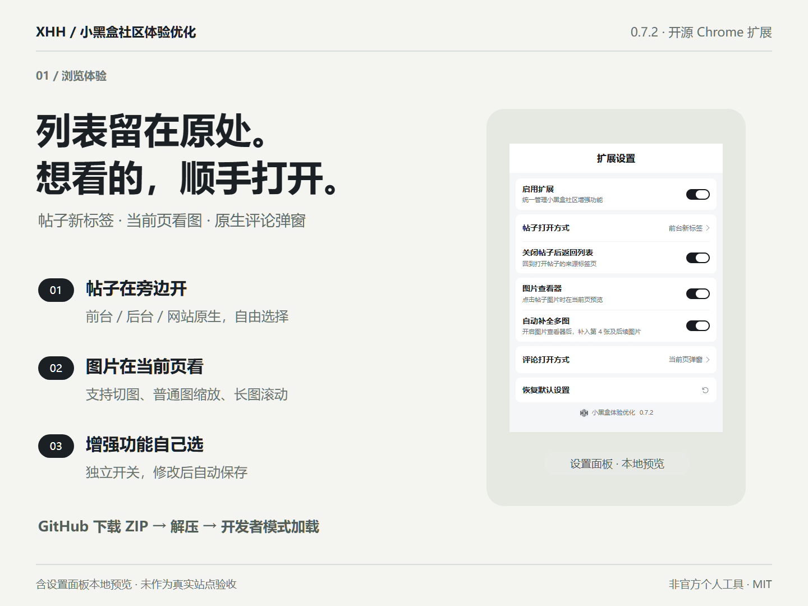
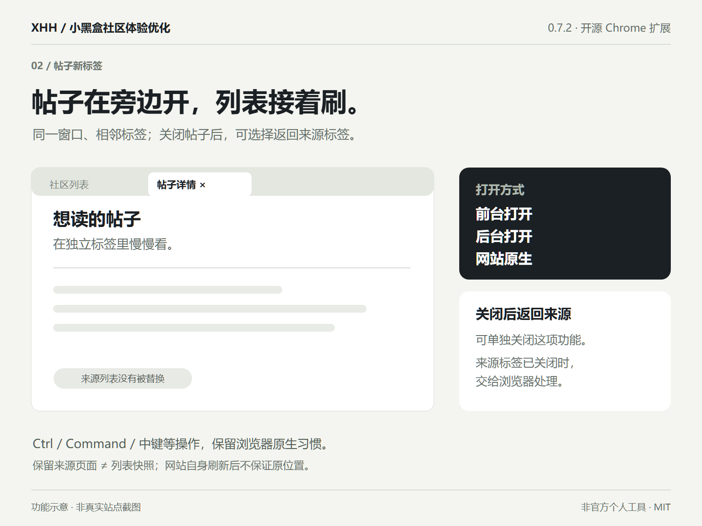
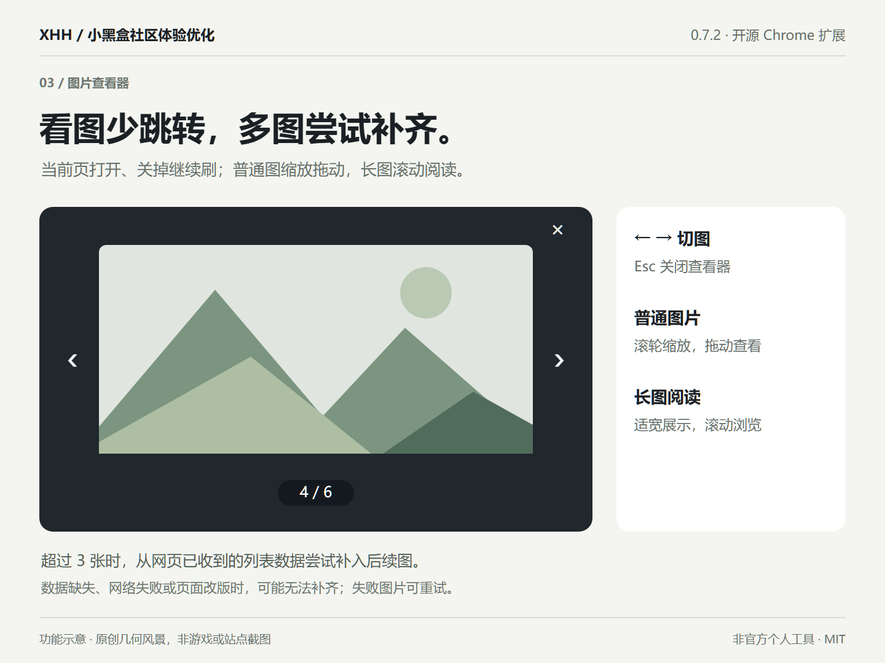
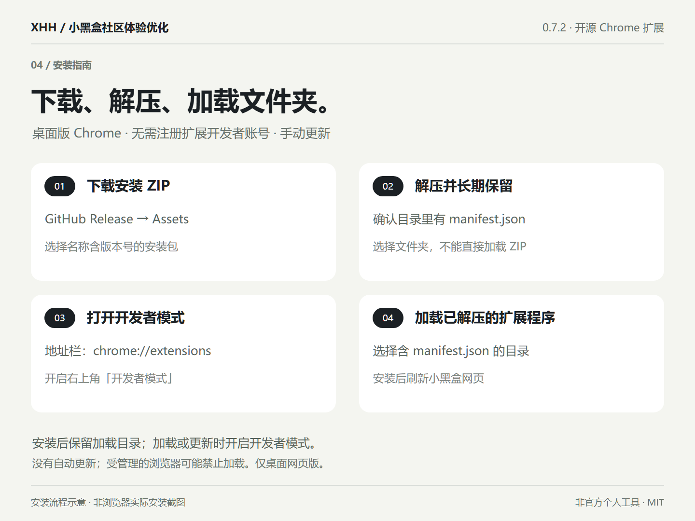

# 小黑盒社区体验优化

一个面向 **小黑盒网页版** 的 Chrome 扩展：把帖子放进相邻标签页，在当前列表预览图片、阅读评论，减少来回跳转。个人制作，非小黑盒官方产品。

**当前版本：0.7.2 · Manifest V3 · MIT 开源**

[下载最新安装包](https://github.com/xleft/xiaoheihe-community-enhancer/releases/latest) · [安装教程](docs/INSTALL.md) · [反馈问题](https://github.com/xleft/xiaoheihe-community-enhancer/issues) · [更新记录](CHANGELOG.md)



## 能做什么

| 功能 | 实际行为 | 可选设置与边界 |
| --- | --- | --- |
| 帖子新标签 | 普通左键点击帖子链接，在来源标签右侧创建帖子标签 | 前台、后台、网站原生三种模式；仅识别小黑盒数字帖子链接 |
| 返回来源列表 | 关闭由扩展打开的帖子标签后，尝试激活来源标签 | 可关闭；来源标签已经关闭时交给浏览器处理，不重建列表 |
| 当前页看图 | 列表正文图片在遮罩查看器中展示，关掉后继续浏览原列表 | 支持左右切图、键盘方向键、Esc 关闭；普通图片滚轮缩放、拖动，长图滚动查看 |
| 补全多图 | 当列表明确显示总图数大于 3，尝试补入第 4 张及之后的图片 | 来自网页已经取得的列表数据；未取得图片或加载失败时可重试，不保证所有帖子都能补齐 |
| 当前页看评论 | 在当前页弹窗内加载网站原生评论页面 | 可切回网站原生；依赖网站登录状态及页面加载，仍会产生网站自身的网络请求 |
| 设置面板 | 总开关、帖子模式、返回来源、图片查看器、多图补全、评论模式、恢复默认 | 自动保存；总开关关闭时暂停新的交互增强，图片查看器关闭时多图补全停用 |

### 帖子在旁边打开，原来的列表留下来

默认以前台新标签打开，也可以设为后台，继续挑选想读的帖子。扩展不重新加载来源列表；如果网站自身更新、重载或改变列表，扩展不提供列表快照恢复。

识别依据是目标帖子链接，支持主站与 `www` 域名、查询参数、尾斜杠。首页、搜索、个人主页、话题页中符合规则的帖子链接可使用新标签逻辑。图片与评论增强依赖完整帖子卡结构；个人“投稿”等紧凑卡片不把封面当作图片画廊。



### 图片与评论留在当前页

前三张图片使用列表已有预览。总图数明确大于 3 时，扩展从页面已经收到的白名单列表响应中匹配后续图片，不再通过隐藏的帖子详情页补图。某张图加载失败不会阻止查看其它已取得图片。

普通图片可滚轮缩放、拖动；长图按适合宽度展示并滚动阅读。查看器内使用左右按钮或方向键切图，Esc 关闭。关闭增强或切回原生模式后，使用网站原来的行为。



### 保留习惯中的原生操作

点赞、头像、用户名、更多按钮、搜索、筛选、视频和音频播放器、输入控件不由帖子跳转逻辑接管。Ctrl / Command / Shift / Alt 与中键点击保留浏览器默认行为。

本版不包含列表点赞增强。**不提供自动点赞、自动评论或批量操作功能。**

## 安装：不用应用商店账号

无需注册 Google / Chrome 扩展开发者账号，使用桌面版 Chrome 的“加载已解压的扩展程序”。

1. 打开 [Releases](https://github.com/xleft/xiaoheihe-community-enhancer/releases/latest)，在 **Assets** 中下载 `xiaoheihe-community-enhancer-0.7.2.zip`。
2. 解压到一个准备长期保留的文件夹，确认其中直接包含 `manifest.json`。
3. 地址栏打开 `chrome://extensions`，开启右上角“开发者模式”。
4. 点击“加载已解压的扩展程序”，选择包含 `manifest.json` 的文件夹。
5. 刷新已经打开的小黑盒网页，在工具栏扩展菜单中打开“小黑盒体验设置”。



**下载 ZIP 后必须先解压；选择文件夹，不是选择 ZIP。安装后不要删除或移动这个文件夹。**

这是手动分发版，没有应用商店自动更新。加载或重新加载时需要开启开发者模式，浏览器可能提示正在使用开发者扩展；单位管理的浏览器可能禁用加载。更新、卸载与常见问题见 [完整教程](docs/INSTALL.md)。

其它 Chromium 浏览器是否兼容需要自行验证；不适用于小黑盒手机 App、Chrome 手机端或 Firefox。

## 权限与数据

| 权限 / 存储 | 用途 |
| --- | --- |
| `tabs` | 创建相邻帖子标签、关闭帖子时激活来源标签 |
| `storage` | 保存开关和模式；在浏览器会话中暂存帖子与来源标签的对应关系 |
| 小黑盒主站与 `www` 域名的页面访问 | 在小黑盒网页上运行帖子、图片、评论增强 |

设置保存在 `chrome.storage.local`，不会通过本扩展跨设备同步；标签来源映射使用 `chrome.storage.session`，不作为永久浏览历史。图片匹配缓存保存在当前页面内存中。

当前代码未接入作者服务器、统计分析、广告或遥测；不要求填写账号密码。小黑盒网站、评论页与图片服务器仍按原有方式处理网站登录和网络请求。补图地址来自网页已经收到的白名单列表响应，不额外请求列表或详情接口；展示及预加载图片仍可能新增图片资源请求。不新增图片接口域名权限，不代表完全离线运行。

总开关控制帖子、图片和评论的交互增强，关闭后页面中的列表响应读取与内存缓存仍继续；已打开帖子保存的返回来源记录也不会被开关撤销。若需停止全部扩展处理，请在 Chrome 扩展管理页停用扩展并刷新网站页面。

## 已验证与已知限制

- 0.7.2 的 7 组测试通过：列表数据桥、模块、后台标签行为、设置、签名工具、静态检查、来源标签策略；原有 17 个 JavaScript 文件语法检查通过。
- 有 380 × 514 设置面板本地预览。本文的标签、图片、安装配图是明确标注的功能示意，**不构成真实小黑盒页面验收证据**。
- 本次公开整理没有重新进行真实站点安装验收，不能承诺所有浏览器版本、帖子结构与账号场景均兼容。
- 网站改版、数据未返回、网络失败、站点限制或其它扩展冲突可能导致局部功能失效；可以关闭对应功能或总开关。
- 返回来源依赖来源标签仍然存在；不提供关闭浏览器后的列表位置恢复。
- 返回来源开关影响之后打开的帖子；已保存来源记录的帖子，关闭时仍可能返回原标签。
- 当前发行整理只更新文档、许可和包装，`manifest.json`、`src/`、`popup/`、`icons/` 与原 0.7.2 一致。安装 ZIP 因新增许可和更新文档而有新的校验值。

## 反馈问题

在 [Issues](https://github.com/xleft/xiaoheihe-community-enhancer/issues) 提供：浏览器版本、扩展版本、发生问题的页面类型、相关开关、复现步骤。可附公开帖子链接和已遮挡私人信息的截图。

**不要上传 Cookie、登录凭据、完整浏览记录或含私人信息的截图。**

## 开发与打包

无需构建前端，扩展入口是根目录 `manifest.json`。运行测试需 Node.js，打包需 Python 3；普通安装使用者不需要安装这些工具。

```sh
node --test tests/*.js
python scripts/package.py
```

打包脚本只收录功能文件、许可和公开安装说明，在 `dist/` 生成安装 ZIP 及 SHA-256 文件；源码与测试直接在本仓库获取。

```text
manifest.json   扩展入口与权限
src/            帖子、图片、评论与设置逻辑
popup/          设置面板
icons/          XHH 几何标志
tests/          7 组测试
docs/           安装说明、介绍帖和配图
scripts/        安装包打包脚本
```

## 许可与说明

本仓库代码与原创说明、示意图使用 [MIT License](LICENSE)。小黑盒名称及网站内容的权利属于各自权利人；开源许可不授予对第三方内容的权利。本项目为非官方个人工具，与小黑盒无隶属或背书关系。
